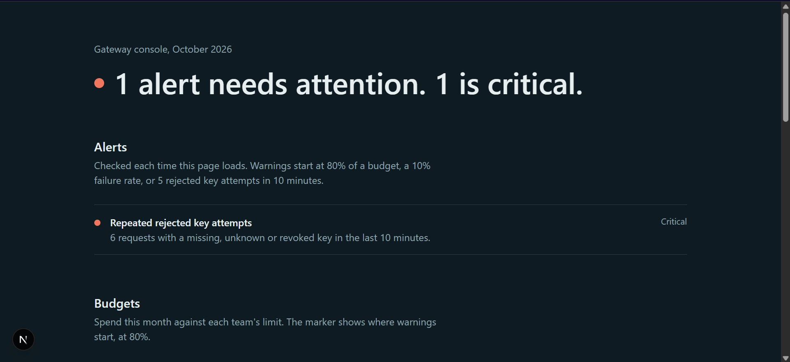
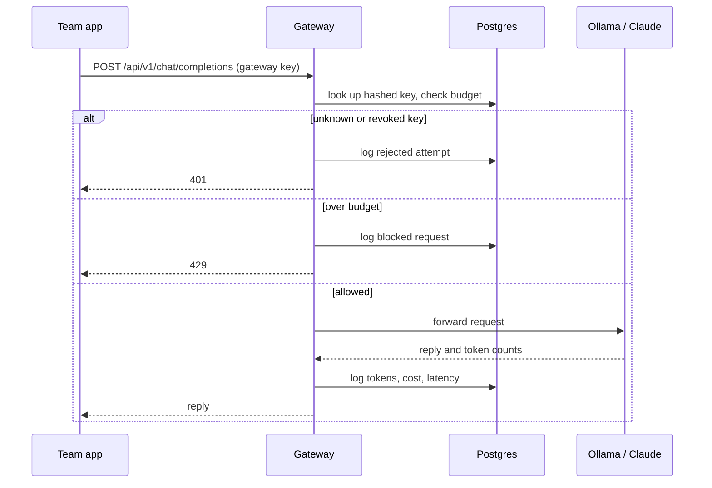
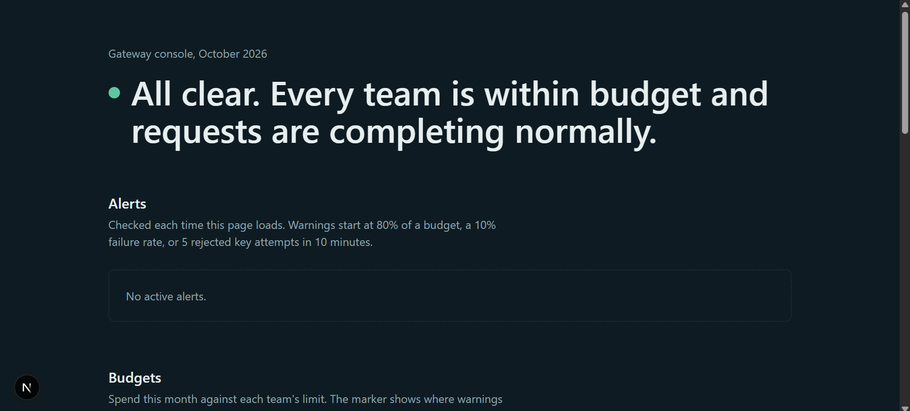
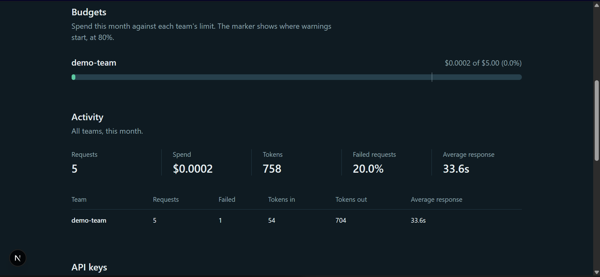
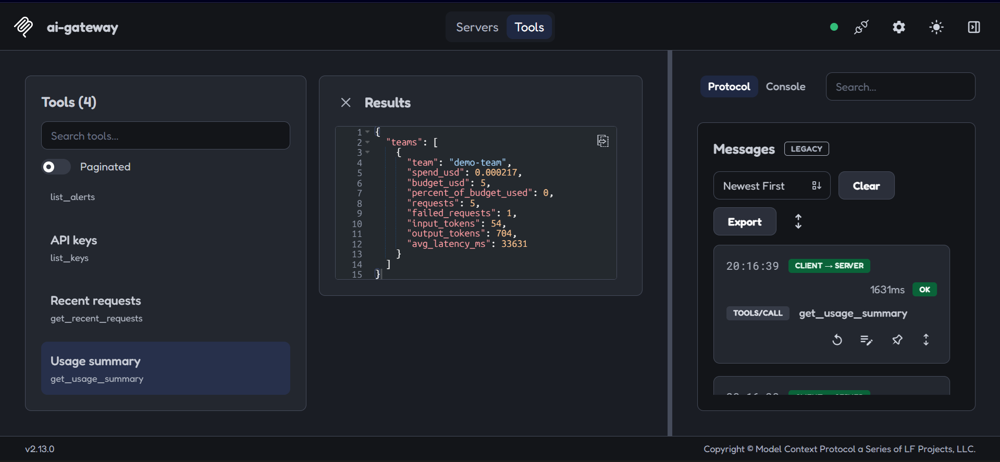

# AI Usage Gateway

A small gateway that sits between teams and an LLM provider. Each team gets its own API key and monthly budget, every request is logged with tokens, cost and latency, and a console shows spend, failures and alerts. A read-only MCP server lets an AI assistant answer operations questions from the same live data.

It runs against a local [Ollama](https://ollama.com) model out of the box, so no paid API key is needed. Anthropic is supported through one setting.



## Why this exists

When several teams share one provider key, nobody can see who spends what, a leaked key means rotating it for everyone, and one runaway script can use up the whole budget. A gateway fixes that: the real provider key stays on the server, and access is governed per team.

## What it does

- **Per-team API keys.** Keys are created and revoked through admin endpoints. Only a SHA-256 hash is stored, and the raw key is shown once at creation.
- **Budget enforcement.** Each team has a monthly budget (UTC calendar month). Requests over budget get a `429` before they reach the model.
- **Usage logging.** Every request records the team, key, model, input and output tokens, cost, latency and result, including blocked and failed requests.
- **Alerts.** The console flags a team at 80% of its budget (critical at 100%), a failure rate above 10% in the last hour, repeated rejected key attempts, and slow responses.
- **Audit trail.** Key creation, key revocation and every MCP tool call are written to an audit log.
- **MCP server.** Four read-only tools expose usage, alerts, keys and recent requests to any MCP client.

## How a request flows



## Screenshots

| Healthy | Budget exceeded |
| --- | --- |
|  |  |



## Stack

Next.js (App Router) and TypeScript, Prisma 6 with PostgreSQL (Neon), Tailwind CSS v4, the Model Context Protocol TypeScript SDK, and Ollama.

## Data model

| Table | Purpose |
| --- | --- |
| `Team` | Name and monthly budget |
| `ApiKey` | Key hash, display prefix, status, last-used time |
| `UsageLog` | One row per request: tokens, cost, latency, status |
| `ModelPrice` | Price per million tokens, maintained by hand |
| `FailedAuth` | Rejected key attempts (feeds the alert) |
| `AuditLog` | Key lifecycle events and MCP tool calls |

## Security decisions

- Keys are high-entropy random strings, stored only as SHA-256 hashes. A database leak does not expose usable keys.
- The provider key lives only in server environment variables.
- Admin routes and the console require an admin token, compared in constant time.
- The MCP server is read-only by design. Revoking keys through an AI assistant is a risky action, so it is not exposed. It never returns key secrets or hashes.
- Failed authentication attempts are recorded, not silently dropped.

## Getting started

Requirements: Node.js 20+, a PostgreSQL database, and Ollama with a model pulled (for example `ollama pull qwen3.5:2b`).

```bash
npm install
cp .env.example .env          # set DATABASE_URL and ADMIN_TOKEN
npm run db:migrate -- --name init
npm run db:seed               # prints a gateway key once, save it
npm run dev
```

Send a request:

```bash
curl -X POST http://localhost:3000/api/v1/chat/completions \
  -H "Authorization: Bearer <gateway key>" \
  -H "content-type: application/json" \
  -d '{"model":"qwen3.5:2b","messages":[{"role":"user","content":"Say hi"}]}'
```

Open the console at `http://localhost:3000/dashboard?token=<ADMIN_TOKEN>`.

Create, list and revoke keys:

```bash
curl -X POST http://localhost:3000/api/admin/keys \
  -H "Authorization: Bearer <ADMIN_TOKEN>" -H "content-type: application/json" \
  -d '{"teamName":"demo-team","label":"my key"}'
curl http://localhost:3000/api/admin/keys -H "Authorization: Bearer <ADMIN_TOKEN>"
curl -X POST http://localhost:3000/api/admin/keys/<id>/revoke -H "Authorization: Bearer <ADMIN_TOKEN>"
```

To use Claude instead of Ollama, set `PROVIDER="anthropic"` and `ANTHROPIC_API_KEY` in `.env`. This path is implemented but not yet tested.

## MCP server

```bash
npm run mcp                                        # stdio server
npx @modelcontextprotocol/inspector npx tsx mcp/server.ts   # try it in a browser
```

| Tool | Returns |
| --- | --- |
| `get_usage_summary` | This month's spend, requests, tokens, failure rate and latency, per team |
| `list_alerts` | Active alerts, optionally critical only |
| `list_keys` | Keys with team, label, status and last-used time (no secrets) |
| `get_recent_requests` | Latest requests, optionally failed only |

## Testing the alerts

A script triggers each alert so you can see it on the console:

```bash
npm run test:alerts -- badkeys   # rejected-key alert
npm run test:alerts -- errors    # failed-requests alert
npm run test:alerts -- budget    # budget alert (leaves it active)
npm run test:alerts -- restore   # undo the budget test
npm run test:alerts -- clean     # remove test records
```

## Known limits and next steps

- The budget check happens before the call, so a single request can overshoot slightly.
- No streaming and no per-key rate limiting yet.
- Alerts are evaluated when the console loads. A real deployment would run them on a schedule and send notifications.
- Admin access is a single shared token, so audit entries record the actor as "admin". The console token travels in the URL, so a proper login should replace it before deployment.
- Prices for local models are notional, so cost figures are illustrative until real prices are set.
- Only Ollama has been tested. OpenAI is not supported yet.
- Tests are manual scripts, with no automated test suite.
- Next steps: scheduled alert checks with notifications, streaming, rate limits, per-user admin accounts, and a p95 latency view.