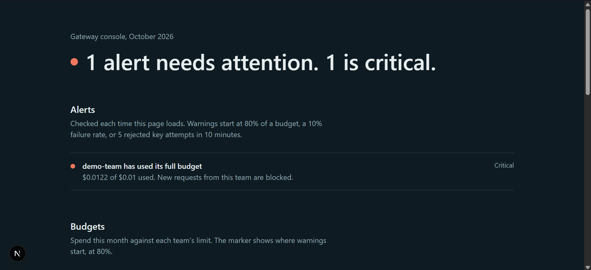

# AI Gateway (starter)

Proxy between teams and an LLM provider (local Ollama by default, Anthropic optional) with per-team keys, budgets and usage logging.

## Setup
```bash
npx create-next-app@latest ai-gateway --ts --tailwind --app --src-dir
cd ai-gateway
npm i @prisma/client
npm i -D prisma tsx
```
Copy these files over the generated project (keep the same paths), then:
```bash
cp .env.example .env        # set DATABASE_URL; make sure Ollama is running (ollama serve)
npx prisma migrate dev --name init
npx tsx scripts/seed.ts     # prints a gateway key once
npm run dev
```

## Try it
```bash
curl -X POST http://localhost:3000/api/v1/chat/completions \
  -H "Authorization: Bearer <gateway key>" \
  -H "content-type: application/json" \
  -d '{"model":"qwen3.5:2b","messages":[{"role":"user","content":"Say hi"}]}'
```
Then check the `UsageLog` table (`npx prisma studio`).

## Known gaps (planned)
- No streaming, no rate limiting, budget check is pre-request (can overshoot slightly)
- No dashboard, alerts, or key management UI yet
- OpenAI provider not added yet; Anthropic is supported via PROVIDER=anthropic but untested

